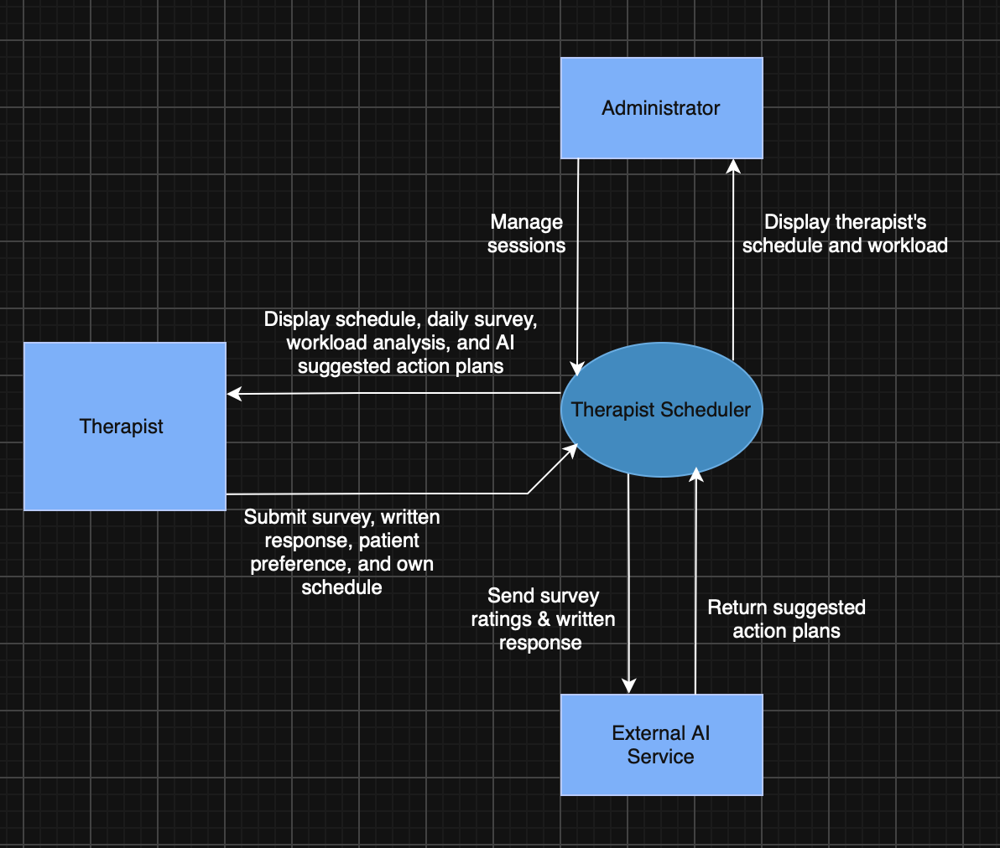

# Design

## Overview

## Architecture

- Web app (React, Netlify): schedules, surveys, workload analysis, action plans.
- API (FastAPI, Oracle Cloud VM): scheduling rules, workload calculations, AI integration.
- SQLite 3, on the VM: therapist and administrator accounts, sessions, daily survey responses, therapist preferences.
- AI (model TBD): suggests action plans based on daily survey responses.

## Interfaces

## Data

## Deployment

## Open questions
How will therapist and administrator accounts be created and managed?

How will we make sure therapist information and survey responses are kept private and secure?

Which AI model or service will we use to generate suggested action plans?

How will we test the connection between the React frontend, FastAPI backend, and SQLite database?

How will we make sure the workload calculations and AI suggestions are accurate and useful?

## Deferred decisions
AI integration: We will focus on getting the main features working before choosing and fully integrating an AI service.

Notifications: We will decide later whether therapists should receive reminders or alerts about their workload.

Database scaling: We will use SQLite for now and consider a larger database if the application needs to support more users.

Additional features: We will prioritize scheduling, daily surveys, and workload tracking before adding more advanced features.

