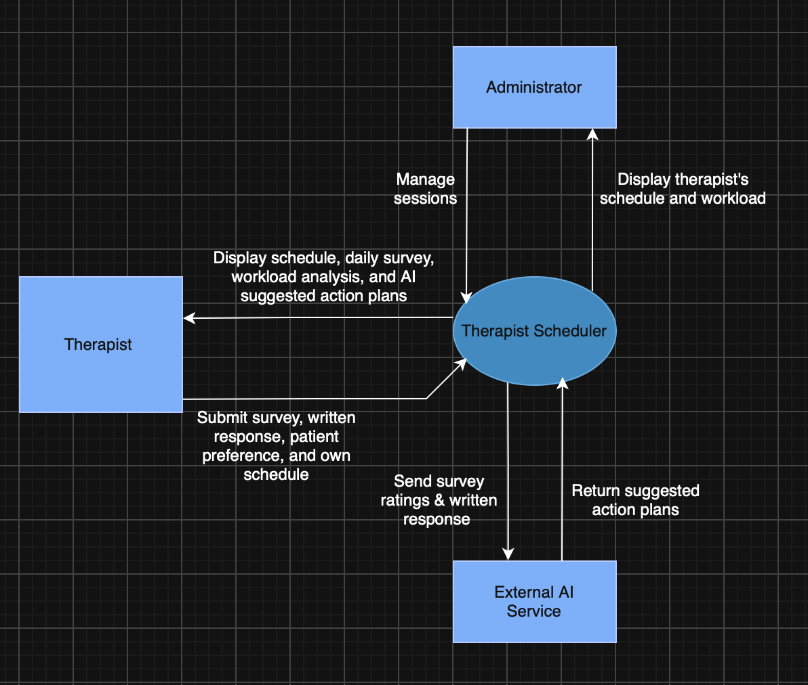

# Design

## Overview

## Architecture

- Web app (React, Netlify): schedules, surveys, workload analysis, action plans.
- API (FastAPI, Oracle Cloud VM): scheduling rules, workload calculations, AI integration.
- SQLite 3, on the VM: therapist and administrator accounts, sessions, daily survey responses, therapist preferences.
- AI (model TBD): suggests action plans based on daily survey responses.

## Interfaces

## Data

## Deployment

## Open questions

## Deferred decisions

